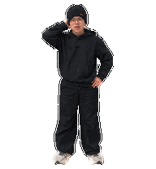
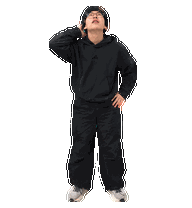

# lwr桌宠 | 介绍与预览

真人照片风格的 ChatGPT Work 桌宠。图集保留人物特征与原始常态手势，包含左右移动、挥手、跳跃、失败、等待、工作、检查，以及 16 个视线方向。

## 动作总览



## 常态


## 16 个视线方向



## 安装资产

使用仓库根目录的 `lwr-pet-v2.png`。它是 1536×2288 的 Pets v2 图集。GIF 与 PNG 方向静帧是预览，不可作为安装文件。

## AI 安装提示词

复制下面内容发给有 ChatGPT Work Pets 工具的 AI。你必须有权访问本私有仓库：

```text
请使用当前对话可用的 Pets 工具，从我有权限访问的 GitHub 私有仓库“lwr桌宠”中取得根目录的 lwr-pet-v2.png，并在 ChatGPT Work 中安装一个名为“lwr桌宠”的自定义桌宠。

请先确认拿到的是仓库里的原始 lwr-pet-v2.png，不要使用任何 GIF 或方向 PNG 预览，也不要重绘、缩放、压缩或修改图集。先运行 Pets v2 图集预检；只有 valid=true 后，才为这份相同文件准备上传、创建桌宠并激活。完成后回读确认稳定 pet ID、名称和 active_pet_id，并告诉我结果。如果私有仓库不可访问或预检失败，请停止并说明原因，不要改用其他文件。
```
